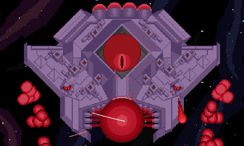
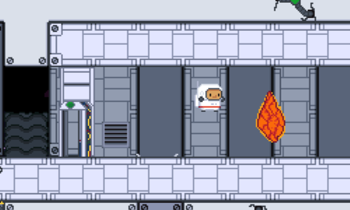
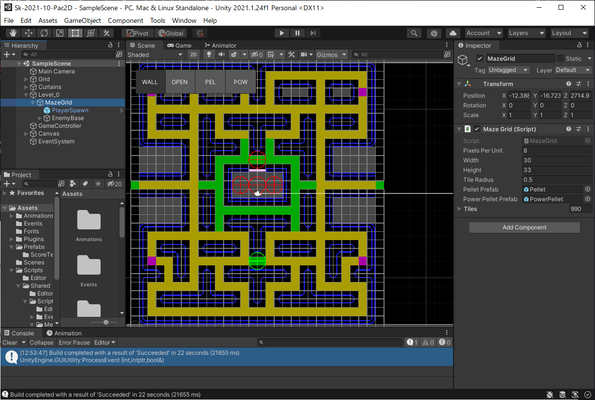
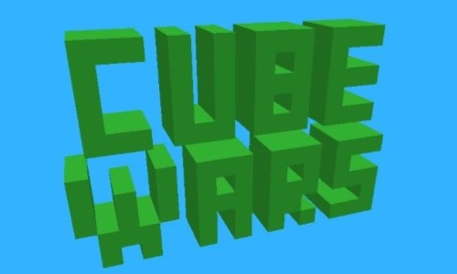

# Portfolio
## Game Development Related

### [Star Gun](portfolio/stargun) (2023)

A vertical slice of a top-scrolling arcade style danmaku game I made in Unity.  This was a project made for an online game design course offered by <a href="https://gamedev.msu.edu/">MSU</a>.  Making it involved creating pixel art animations, sound effects, and level sequencing tools to supplement the basic assets provided.  However for me the most impactful experience from it was the importance of controlling scope.  I set out from the start to make this as a vertical slice, and it shows in the level of polish on the final product.

*[More details available here](portfolio/stargun)*

Release build:&emsp;*<a href="https://mvest.itch.io/msu-2d-shooter"> mvest.itch.io/msu-2d-shooter</a>* 
Source code:&emsp;*<a href="https://github.com/mvestrand/MSU-2DShooter">github.com/mvestrand/MSU-2DShooter</a>*

### [2D Platformer Prototype](portfolio/2dplatformer) (2023)

A partially complete 2d platformer made in Godot for the same online course as Star Gun.  It was ultimately abandoned along with the rest of the course after becoming disillusioned with the online course's lack of feedback and engagement.  I was still in the middle of working out mechanics, movement, and camera behavior, so there is only one level and some simple obstacles made for testing.  The main takeaway from it for me was the need for community—for other people to share ideas with, look to for advice, and get feedback from.

*[More details available here](portfolio/2dplatformer)*

Test build:&emsp;*<a href="https://github.com/mvestrand/msu-2dplatformer/releases/tag/v0.1">github.com/mvestrand/msu-2dplatformer/releases/tag/v0.1</a>*  
Source code:&emsp;*<a href="https://github.com/mvestrand/msu-2dplatformer">github.com/mvestrand/msu-2dplatformer</a>*  

### Personal unity tools library (2023)
A Unity package containing various bits of Unity c# code.  There's code for object pooling, type serialization, and scriptable variables (i.e. ScriptableObject data asset-based, injectable global variables).  Initially built directly into the code of other projects, I split them off into a Unity package to be able to easily add and reuse them across projects.

Source code:&emsp;*<a href="https://github.com/mvestrand/unity-tools">https://github.com/mvestrand/unity-tools</a>*  

### Basic Pacman Clone (2021)
<figure style="max-width: 500px; margin:0;" >

<figcaption style="font-size:11px; text-align:center; margin:5px;">The custom spawning and pathing tilemap editor in Unity.</figcaption>
</figure>

A basic recreation of pacman in Unity. I ended up making this as a way to learn and practice using Unity without also trying to design a game at the same time. I had used Unity some before this, but this was the first time making editor tools for it.  

Test build:&emsp;*<a href="https://github.com/mvestrand/pacman-clone/releases/tag/v0.1">github.com/mvestrand/pacman-clone/releases/tag/v0.1</a>*  
Source code:&emsp;*<a href="https://github.com/mvestrand/pacman-clone">github.com/mvestrand/pacman-clone</a>*  

### Application and Physics Engine Code (2015-2018)
This is a collection of code made over several years while I was an undergrad to try out things I was learning through independent study.  It isn't an example of excellent coding or finished creative work, but it's important to include for the variety of knowledge and lessons learned from it.  There's code for doing basic rendering in OpenGL, loading of obj files and textures, audio using SDL.  There's code for basic broadphase collision detection, alongside a basic impulse-based physics engine written while following along with a textbook. There's the rough beginnings of an object and scene system in it. At one point it was a little asteroids game.

I learned about a variety of the systems and architecture underneath games, but after spending years trying to do everything on my own, it was the more general development lessons from it that really mattered.  The most important being—alongside the importance of source control, organization, documentation—to follow the oft-repeated advice: "Don't reinvent the wheel."  Use game engines and existing libraries over making your own whenever possible.  When using a game engine, it's easy to forget just how much work goes into the design, creation, and maintenance of that underlying framework.  It's certainly helpful to understand how they work for the sake of better utilizing and when *truly* necessary modifying them, but choosing not to use existing tools always comes at the cost of having to build and maintain those new tools yourself.  A cost you almost never want to pay if you can avoid it, as those resources could be better spent on creating the game itself.

Source code:&emsp;*<a href="https://github.com/mvestrand/old-app-code">github.com/mvestrand/old-app-code</a>*  

### [Cube Wars](portfolio/cube-wars) (2014)

A *very* minimal game I made when first learning OpenGL.  

*[More details available here](portfolio/cube-wars)*

Source code:&emsp;*<a href="https://github.com/mvestrand/cube-wars">github.com/mvestrand/cube-wars</a>*  

## Data Science Related

#### [MovieLens](https://github.com/mvestrand/MovieLens) (2020)
A project analyzing the MovieLens database and using a matrix factorization model to recommend films.  It was for a HarvardX data science course, and is written in R.

#### [Tennis](https://github.com/mvestrand/Tennis) (2020)
Capstone project for a HarvardX data science course, doing analysis on Tennis match data and attempting to predict match outcomes.

